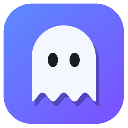
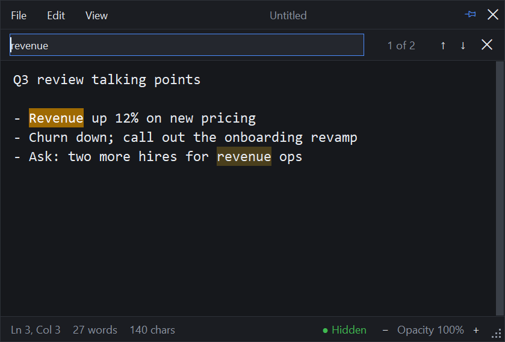

<p align="center">
  
</p>

<h1 align="center">Ghostpad</h1>

<p align="center">
  A private, always-on-top scratchpad for Windows that screen sharing cannot see.
</p>

<p align="center">
  <a href="https://github.com/rahullsing/GhostPad/actions/workflows/ci.yml"></a>
  <a href="LICENSE"></a>
  
</p>

<p align="center">
  
</p>

Keep speaker notes, talking points or a checklist on screen during a meeting or
presentation. You can see Ghostpad, but Zoom, Teams, Google Meet, OBS and
screenshots cannot.

## Features

- **Invisible to screen capture.** The window, its menus and its dialogs are
  excluded from screen sharing, recordings and screenshots. A status-bar
  indicator confirms that protection is active.
- **Global hotkeys.** These work while another app, such as PowerPoint, has focus:
  - <kbd>Ctrl</kbd>+<kbd>Space</kbd> shows or hides Ghostpad.
  - <kbd>Ctrl</kbd>+<kbd>Alt</kbd>+<kbd>↑</kbd>/<kbd>↓</kbd> scrolls your notes
    without switching windows.
- **Nothing gets lost.** Untitled notes autosave. Window position, size, zoom,
  opacity and the last opened file are restored on the next launch.
- **Find bar.** All matches are highlighted, and the bar shows a running count.
- **Always on top, adjustable opacity.** A borderless dark UI that stays out of
  the way.
- **Single instance.** Launching Ghostpad again brings the running window to
  the front.
- **No dependencies.** Pure Python standard library (`tkinter` + `ctypes`).

## Requirements

- **OS:** Windows 10 version 2004 (build 19041) or later, or Windows 11.
  Older Windows versions show Ghostpad as a black box in captures instead of
  hiding it.
- **Python:** 3.10 or later, only to run from source or build. The packaged
  `.exe` needs no Python.

## Install

There are three ways to run Ghostpad:

- **Installer (recommended).** Run `Ghostpad-Setup-<version>.exe` and follow
  the wizard. It needs no admin rights. It adds a Start-menu shortcut and
  optionally a desktop shortcut and start at sign-in. Uninstall it from
  **Settings → Apps**.
- **Portable.** Unzip `Ghostpad-<version>-portable.zip` anywhere and run
  `Ghostpad\Ghostpad.exe`. No Python needed.
- **From source.** This needs Python 3.10 or later:

  ```powershell
  git clone https://github.com/rahullsing/GhostPad.git ghostpad
  cd ghostpad
  pythonw ghostpad.pyw            # or double-click ghostpad.pyw
  pythonw ghostpad.pyw notes.txt  # open a file directly
  ```

## Build the exe, zip and installer

One command runs the tests, then builds all three:

```powershell
python -m pip install -r requirements-dev.txt         # once
winget install --id JRSoftware.InnoSetup -e --scope user  # once, for the installer
powershell -ExecutionPolicy Bypass -File tools\build.ps1
```

| Output | What it is |
| --- | --- |
| `dist\Ghostpad\Ghostpad.exe` | The compiled app (keep the folder together) |
| `dist\Ghostpad-<version>-portable.zip` | Portable copy for other PCs |
| `dist\installer\Ghostpad-Setup-<version>.exe` | Installer wizard |

[docs/BUILDING.md](docs/BUILDING.md) is the full guide. It covers manual build
steps, running on other PCs, SmartScreen and antivirus warnings, silent
installs for IT, code signing and troubleshooting.

## Keyboard shortcuts

| Action | Shortcut |
| --- | --- |
| Show / hide (global) | <kbd>Ctrl</kbd>+<kbd>Space</kbd> |
| Scroll notes up / down (global) | <kbd>Ctrl</kbd>+<kbd>Alt</kbd>+<kbd>↑</kbd> / <kbd>↓</kbd> |
| New / Open / Save / Save As | <kbd>Ctrl</kbd>+<kbd>N</kbd> / <kbd>O</kbd> / <kbd>S</kbd> / <kbd>Shift</kbd>+<kbd>S</kbd> |
| Find / next / previous | <kbd>Ctrl</kbd>+<kbd>F</kbd> / <kbd>F3</kbd> / <kbd>Shift</kbd>+<kbd>F3</kbd> |
| Zoom in / out / reset | <kbd>Ctrl</kbd>+<kbd>+</kbd> / <kbd>-</kbd> / <kbd>0</kbd>, or <kbd>Ctrl</kbd>+mouse wheel |
| Select all / clear | <kbd>Ctrl</kbd>+<kbd>A</kbd> / <kbd>Ctrl</kbd>+<kbd>L</kbd> |
| Open File / Edit / View menu | <kbd>Alt</kbd>+<kbd>F</kbd> / <kbd>E</kbd> / <kbd>V</kbd> |

Other controls:

- **Move the window:** drag the title bar.
- **Resize the window:** drag the grip in the bottom-right corner.
- **Always on top:** the pin button toggles it.
- **Opacity:** use the **−** and **+** buttons in the status bar.

## How invisible is it?

Ghostpad asks Windows to exclude its windows from capture with
`SetWindowDisplayAffinity(WDA_EXCLUDEFROMCAPTURE)`. Windows enforces this for
every capture method that goes through the desktop compositor. That covers
Zoom, Microsoft Teams, Google Meet and other browser-based sharing, Webex,
Discord, Slack, OBS, the Snipping Tool and <kbd>PrtScn</kbd>.

Watch the status-bar indicator:

| Indicator | Meaning |
| --- | --- |
| 🟢 **Hidden** | Every Ghostpad window is excluded from capture. |
| 🟡 **Blacked out** | Windows is older than 10 version 2004, so Ghostpad shows as a black box. |
| 🔴 **VISIBLE** | Windows refused protection. Assume others can see it. |

No software can hide from:

- A camera or phone pointed at your monitor.
- Hardware capture: HDMI capture cards, or a screen mirrored to a projector or TV.
- Remote-desktop and remote-control tools. These are untested, so check yours.

Sharing the Ghostpad window itself shows a blank or black area.

Do a quick test share before relying on Ghostpad in an important meeting. See
[SECURITY.md](SECURITY.md) for the full threat model and
[docs/ARCHITECTURE.md](docs/ARCHITECTURE.md) for how the protection works.

## Where your data is stored

| File | Purpose |
| --- | --- |
| `%APPDATA%\Ghostpad\scratch.txt` | Autosaved untitled note |
| `%APPDATA%\Ghostpad\settings.json` | Window position and size, zoom, opacity, toggles, last opened file |

Ghostpad sends no data anywhere. It makes no network calls and collects no
telemetry. To reset it, close Ghostpad and delete the `%APPDATA%\Ghostpad`
folder.

## Project structure

```text
ghostpad.pyw            Application (single module, standard library only)
Ghostpad.spec           PyInstaller build definition (exe, icon, version info)
installer/ghostpad.iss  Inno Setup script for the installer wizard
tools/build.ps1         One-command build: tests, exe, portable zip, installer
tools/make_icon.py      Regenerates the icon from code
assets/                 App icon (.ico) and README image
tests/                  Unit and integration tests (unittest)
docs/                   Build guide, architecture notes, screenshot
```

## Development

For setup, coding standards, testing and the release process, see
[CONTRIBUTING.md](CONTRIBUTING.md). In short:

```powershell
python -m pip install -r requirements-dev.txt
python -m unittest discover -s tests -v
python -m ruff check . ; python -m ruff format --check . ; python -m mypy
```

## Changelog

See [CHANGELOG.md](CHANGELOG.md).

## License

[MIT](LICENSE)
